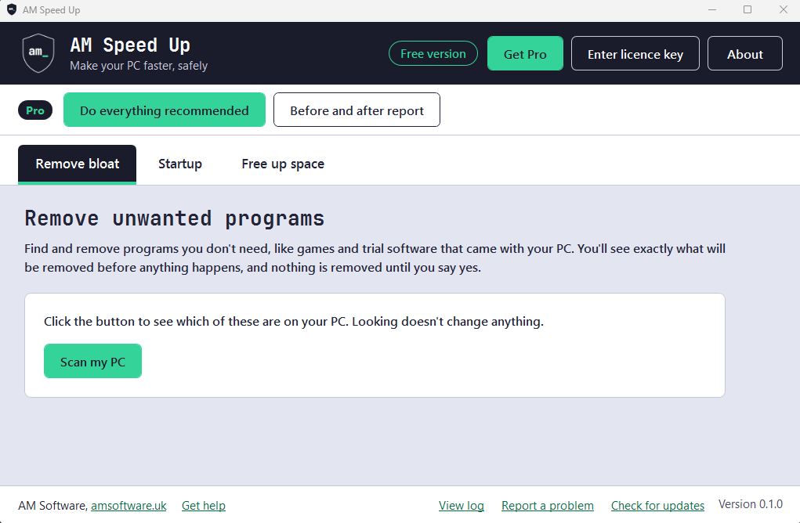
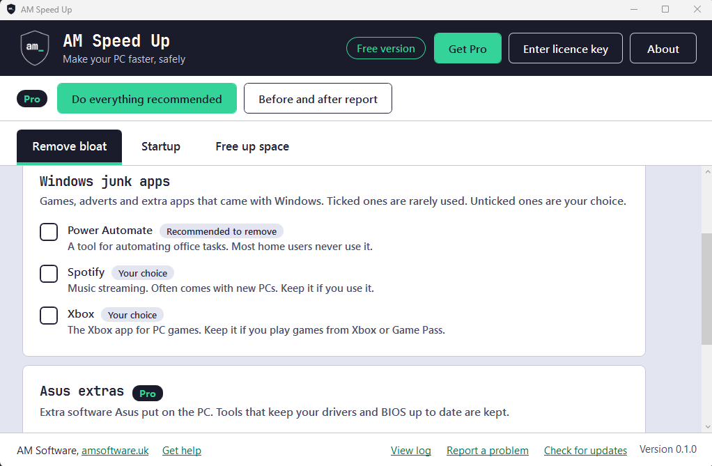
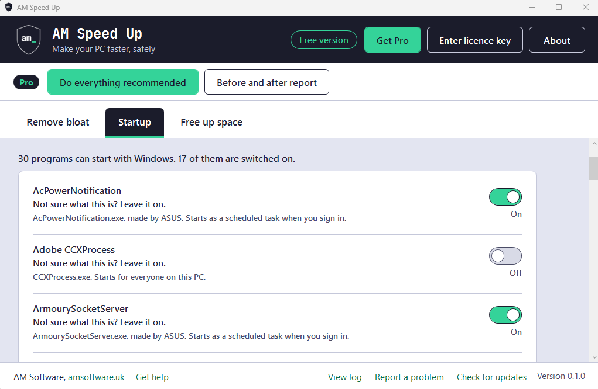
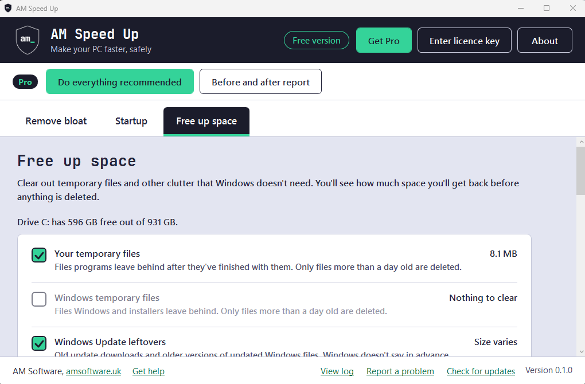
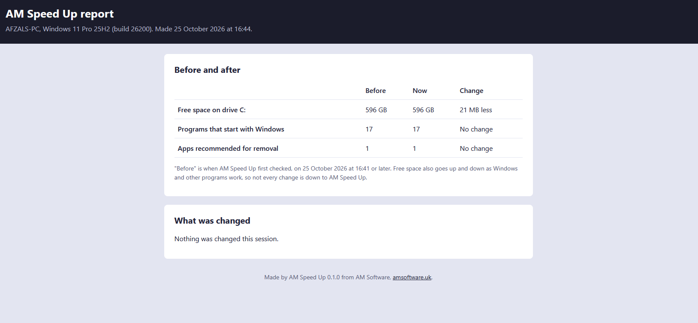

<p align="center">
  
</p>

# AM Speed Up

AM Speed Up helps you make a slow Windows PC feel quicker, without needing to be good with computers. It removes programs you don't need, like preinstalled games and trial antivirus. It lets you choose what starts when you turn your PC on, and clears out files Windows no longer needs. Before anything changes, it shows you exactly what will happen and waits for you to say yes.

It's made by [AM Software](https://www.amsoftware.uk), a small computer repair business.

<p align="center">
  <a href="https://github.com/afzalmussa/am-speed-up/releases/latest/download/AMSpeedUp.exe"><strong>Download AM Speed Up for Windows</strong></a>
</p>

There's nothing to install. Download `AMSpeedUp.exe`, then double-click it to open it. Older versions and the list of changes are on the [Releases page](https://github.com/afzalmussa/am-speed-up/releases).

<p align="center">
  
</p>

## Contents

- [Is it safe?](#is-it-safe)
- [What it removes](#what-it-removes)
- [Free and Pro](#free-and-pro)
- [How to undo changes](#how-to-undo-changes)
- [System requirements](#system-requirements)
- [Privacy](#privacy)
- [Help and support](#help-and-support)
- [For developers](#for-developers)
- [Licence](#licence)

## Is it safe?

AM Speed Up is made for people who are nervous about breaking something. These safety rules are built into the app itself, not just the screens, and they're always free:

- **You see everything first.** Every change is shown as a checklist, along with how it can be undone. Nothing happens until you click to confirm.
- **A restore point is made first.** Before removing anything, the app asks Windows to save a System Restore point, so you can wind your PC back to how it was. If Windows can't make one (for example, System Restore is switched off), the app explains why and asks whether you want to carry on or stop.
- **Important parts of Windows can't be removed.** The Microsoft Store, App Installer, Microsoft Edge, WebView2, .NET and Visual C++ runtimes, Windows Security, drivers and anything that's part of Windows are on a protected list. The app checks that list again just before every removal and won't touch anything on it.
- **You're never left without antivirus.** After removing a trial antivirus, the app checks that Windows' own antivirus (Microsoft Defender) is switched on. If it isn't, you get a clear warning with a button that opens Windows Security.
- **McAfee and Norton are removed with their own tools.** These don't uninstall cleanly the normal way, so the app downloads McAfee's or Norton's official removal tool from their own website. It checks the tool's digital signature first, and won't run it if the check fails.
- **Everything is written down.** Every action, and whether it worked, is saved in a log file. Click "View log" at the bottom of the window to read it. The logs are kept in `C:\ProgramData\AMSoftware\SpeedUp\logs`.

### The warnings you'll see when you open it

**"Windows protected your PC".** Windows SmartScreen shows this blue box for programs it hasn't seen many people use yet, especially ones without a digital code-signing certificate. AM Speed Up doesn't have one yet, because they cost money every year. It will get one before Pro goes on general sale. Until then, click **More info**, check the file is called `AMSpeedUp.exe`, then click **Run anyway**. If you'd rather not, that's a sensible choice too. AM Software can run it for you.

**"Do you want to allow this app to make changes to your device?"** AM Speed Up needs administrator permission to remove programs and change startup settings, so Windows asks every time it opens. It will say "Unknown publisher" for the same reason as above. Click **Yes** to carry on.

**Checking your download.** Each release also has a file called `AMSpeedUp.exe.sha256`, which holds a fingerprint of the real file. To check yours matches, open PowerShell in your Downloads folder and run `Get-FileHash AMSpeedUp.exe`, then compare the long number with the one in the `.sha256` file. You don't need to do this, but you can.

## What it removes

AM Speed Up only offers to remove things on its lists. Anything else on your PC is left alone. The lists are plain text files you can read:

| List | What's on it | Free or Pro |
| --- | --- | --- |
| [Windows junk apps](presets/windows-junk.json) | Games, adverts and extra apps that come with Windows, like Candy Crush, Solitaire and Tips. Some, like Spotify or Xbox, are shown unticked because you might use them | Free |
| [Trial antivirus](presets/trial-antivirus.json) | McAfee and Norton trials that came with the PC | Free |
| [HP extras](presets/hp-extras.json), [Dell extras](presets/dell-extras.json), [Lenovo extras](presets/lenovo-extras.json), [Acer extras](presets/acer-extras.json), [Asus extras](presets/asus-extras.json) | Extra software the manufacturer put on the PC. Tools that keep your drivers and BIOS up to date are always marked "Worth keeping", with the reason | Pro |

Each item is marked "Recommended to remove" (ticked), "Your choice" (not ticked) or "Worth keeping" (not ticked, with the reason). You can untick anything before you confirm.

<p align="center">
  
</p>

The Startup tab uses [a list of common startup programs](data/startup-known.json) to explain what each one is. If it doesn't recognise a program, it says "Not sure what this is? Leave it on."

<p align="center">
  
</p>

The Free up space tab clears temporary files, Windows Update leftovers and the caches of Microsoft Edge, Google Chrome and Firefox. A browser's cache is only cleared if that browser is closed. Your passwords, bookmarks and history aren't touched. The Recycle Bin is shown too, but it's never ticked for you, because it holds files you've deleted.

<p align="center">
  
</p>

How the lists work, and how to suggest a new entry, is in [presets/README.md](presets/README.md).

## Free and Pro

| | Free | Pro |
| --- | :---: | :---: |
| Remove Windows junk apps and trial antivirus | Yes | Yes |
| Choose what starts with your PC | Yes | Yes |
| Free up space | Yes | Yes |
| Every safety feature: preview, restore point, protected list, antivirus check, logs and undo | Yes | Yes |
| Remove HP, Dell, Lenovo, Acer and Asus extras | | Yes |
| **Do everything recommended**: all three tabs in one go, with one preview to check first | | Yes |
| **Monthly tune-up**: clears clutter automatically once a month (never removes programs) | | Yes |
| **Large file and duplicate finder**: find big files and copies, and move them to the Recycle Bin | | Yes |
| **Before and after report**: a page showing what changed, to keep, print or email | | Yes |

<p align="center">
  
  <br><em>The before and after report (Pro)</em>
</p>

Pro is a licence key you buy from AM Software. Click **Get Pro** in the app to buy one, then **Enter licence key** to start using it. One key works on a set number of PCs, shown when you buy. To move Pro to a different PC, open **Enter licence key** and click **Remove this PC**.

The app checks your key online once a week. If your PC is offline, Pro keeps working for 30 days. After that, Pro features pause until the app can check your key once more, and nothing is lost. Pro only stops for good if your key has expired or been cancelled.

## How to undo changes

What you can undo depends on the change. The preview tells you which kind each one is before you confirm.

| What changed | How to undo it |
| --- | --- |
| A startup program switched off | On the **Startup** tab, switch it back on and apply. It starts again the next time you start your PC |
| A Microsoft Store app removed | On the **Remove bloat** tab, find it under **Removed earlier** and click **Reinstall**. This opens the Microsoft Store so you can get it back |
| A desktop program removed | Use the restore point. Click **Open System Restore** on the Remove bloat tab and choose the point called "AM Speed Up: before removing apps". Or reinstall the program from the maker's website |
| Files moved by the large file finder | They're in the Recycle Bin. Open it, right-click the file and choose **Restore** |
| Temporary files and caches cleared | These can't be put back, and you won't need them. Windows and your browsers make new ones as they need them |
| The monthly tune-up switched on | On the **Free up space** tab, click **Turn off the monthly tune-up** |

Going back to a restore point undoes every program and setting change made since it was saved, not just AM Speed Up's. Your own documents and photos aren't affected.

## System requirements

- Windows 10 or Windows 11, 64-bit
- An account that can approve administrator permission (Windows asks when the app opens)
- An internet connection only for checking a Pro key, or for downloading McAfee's or Norton's removal tool. Everything else works offline

## Privacy

AM Speed Up doesn't collect information about you or your PC, and has no tracking or analytics. It only goes online to:

- **Check a Pro licence key** with Lemon Squeezy, who sell AM Speed Up Pro on AM Software's behalf. Only the key and a random label for the PC are sent.
- **Download McAfee's or Norton's own removal tool** from their website, if you choose to remove one of them.

Links you click, like "Get help", open in your web browser.

## Help and support

- **Need help?** Contact AM Software at https://www.amsoftware.uk/contact
- **Something went wrong, or have an idea?** [Tell us on GitHub](https://github.com/afzalmussa/am-speed-up/issues). Attaching your log file (click "View log" in the app) helps a lot.
- **Want to say thanks?** There's a Donate button in the app's About window.

---

## For developers

### Building from source

You'll need Windows 10 or 11 and the [.NET 10 SDK](https://dotnet.microsoft.com/download).

```powershell
git clone https://github.com/afzalmussa/am-speed-up.git
cd am-speed-up
dotnet build AMSpeedUp.sln
dotnet test AMSpeedUp.sln
```

To build the single-file app:

```powershell
dotnet publish src/AMSpeedUp -c Release -o publish
```

This produces `publish/AMSpeedUp.exe`, which runs on its own without .NET installed. It asks for administrator permission when it opens.

### Running the tests

```powershell
dotnet test AMSpeedUp.sln
```

There are three test projects:

| Project | What it tests | Where it runs |
| --- | --- | --- |
| `tests/AMSpeedUp.Tests` | Core logic: the safety rules, protected list, presets, recommendations, licence states (valid, invalid, expired, offline grace, developer mode), space sums, the tune-up schedule and the report | Any OS, including Linux and macOS |
| `tests/AMSpeedUp.UI.Tests` | View models, every window loading, and the layout at 125% and 150% scaling. With `SCREENSHOT_DIR` set, it saves a picture of each screen | Windows |
| `tests/AMSpeedUp.Windows.Tests` | The real Windows services, run against Windows itself. Apart from their own temporary test files, a test file sent to the Recycle Bin and a switched-off test task that's removed again, they only read | Windows |

The tests that download McAfee's and Norton's removal tools are tagged `VendorDownload`. Skip them with `--filter "Category!=VendorDownload"`. A separate workflow runs them once a month to catch moved download links.

Core has no Windows-only code, so its tests also run on Linux:

```bash
dotnet test tests/AMSpeedUp.Tests
```

For testing the app itself on a PC, see [TESTING.md](TESTING.md).

### Test mode and developer options

| Option | What it does |
| --- | --- |
| `AMSpeedUp.exe --dry-run` | Test mode. Everything works as normal and a yellow banner is shown, but nothing on the PC is changed. The log says what would have happened |
| `AMSPEEDUP_DEV_PRO=1` | Debug builds only: pretends a Pro licence is active, so Pro features can be tested without a key. Release builds ignore it |

### Project layout

| Folder | What's in it |
| --- | --- |
| `src/AMSpeedUp` | The WPF app (windows, view models, styles) |
| `src/AMSpeedUp.Core` | Logic, presets, licensing and service interfaces. No UI and no Windows-only APIs |
| `src/AMSpeedUp.Windows` | The real Windows implementations of the service interfaces (PowerShell, registry, DPAPI, System Restore, Task Scheduler) |
| `tests/` | The three test projects above |
| `presets` | The lists of apps the app can offer to remove. See [presets/README.md](presets/README.md) |
| `data` | `startup-known.json`: plain descriptions and advice for common startup programs |
| `assets` | Logo, icon, fonts and the screenshots used in this README |

Licensing is behind `ILicenceService`, with a Lemon Squeezy implementation. The checkout link and store details are in `src/AMSpeedUp.Core/Configuration/appsettings.json`. No API keys or secrets are in the app or this repo: the Lemon Squeezy License API doesn't need one.

### Releases

Pushing a tag like `v0.1.0` runs the release workflow, which tests the code, builds `AMSpeedUp.exe` and attaches it to a GitHub Release named after the tag, with a SHA-256 checksum. The file is always called `AMSpeedUp.exe` so the download link keeps working. A tag with a dash, like `v0.2.0-beta.1`, is published as a pre-release.

### Contributions

Thanks for your interest. Code contributions aren't being accepted at the moment, but bug reports and ideas are very welcome through [Issues](https://github.com/afzalmussa/am-speed-up/issues).

## Licence

**Using the app:** anyone, including businesses and other organisations, may download and use the official releases of AM Speed Up from the [Releases page](https://github.com/afzalmussa/am-speed-up/releases). Pro features need a licence key.

**Using the source code:** the code is available under the [PolyForm Noncommercial License 1.0.0](LICENSE). You're welcome to read it, build it and change it for personal and other noncommercial use, but you may not sell it, redistribute it or use the code commercially without permission from AM Software. This is a "source available" licence rather than an open source one.

The exact terms, including the extra permission for using official releases, are in [LICENSE](LICENSE).

Third-party components and their licences are listed in [THIRD-PARTY-NOTICES.md](THIRD-PARTY-NOTICES.md).

AM Speed Up is made by AM Software, [amsoftware.uk](https://www.amsoftware.uk).
